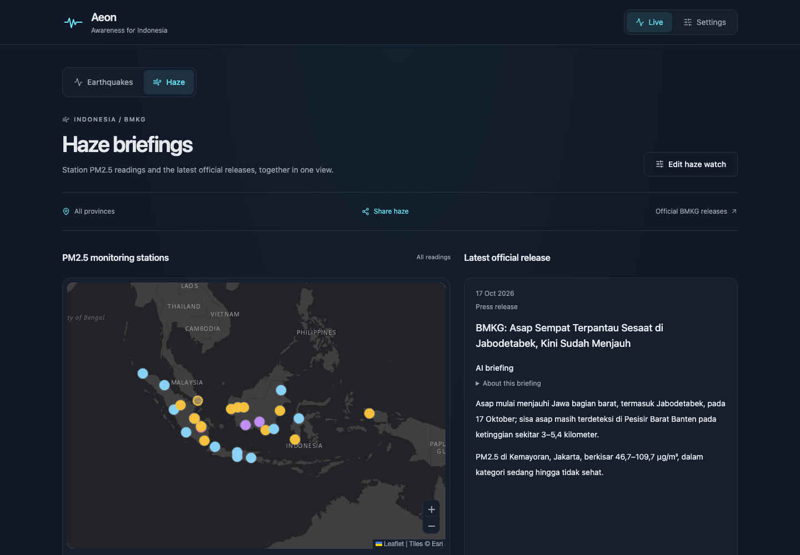

<div align="center">

# Aeon for Android

**Earthquake and air quality awareness for Indonesia.**

[Download APK](https://github.com/Omnific-Tech/aeon-android/releases/latest) · [Open Aeon](https://app.aeon.omnific.dev/) · [Herald Android](https://github.com/Omnific-Tech/herald-android-oss) · [Omnific Tech](https://omnific.dev/)

</div>

Aeon helps you follow earthquakes and air quality using Indonesia's BMKG data. Explore the map, follow recent events and PM2.5 readings, and choose the provinces and thresholds that matter to you.

The Android app opens Aeon's PWA in a **Trusted Web Activity** and delivers notifications natively through [Herald Android](https://github.com/Omnific-Tech/herald-android-oss). Notification preferences are managed in Aeon; device credentials stay inside the app.

This repository contains the **Android distribution**: app identity, configuration, icons, and release pipeline. Aeon's web application and backend are maintained separately.



## Install

1. Download the `.apk` asset from [GitHub Releases](https://github.com/Omnific-Tech/aeon-android/releases/latest).
2. Allow your browser or file manager to install apps when Android prompts, then open the APK.
3. Open Aeon, choose what to watch, and allow notifications if you want alerts.

Requires **Android 8.0 (API 26) or newer**, a compatible TWA browser, and an internet connection. Aeon loads from the web; this is not an offline client. Each release includes APK checksums, its signing certificate fingerprint, and dependency notices.

## Build from source

Requires **JDK 21**, Android SDK platform **37.2**, and build-tools **37.0.0**. Set `ANDROID_HOME` and put the SDK command-line tools on `PATH`.

```sh
./gradlew :app:assembleDebug :app:releaseNotices :app:lint
```

Debug APK: `app/build/outputs/apk/debug/app-debug.apk`. Minified, unsigned release APK: `app/build/outputs/apk/release/app-release-unsigned.apk`. Dependency notices: `app/build/outputs/notices/THIRD-PARTY-NOTICES.zip`.

The versioned core Maven ZIP is committed under `vendor/`; Gradle verifies its SHA-256 before extraction. Public Android and Firebase dependencies still require network access on the first build. No private source checkout is required.

| File | Purpose |
| --- | --- |
| `gradle.properties` | Application ID, app/core versions, expected signing certificate |
| `app/src/main/assets/herald.json` | Broker, PWA origin, notification channels, subscription bridge |
| `app/src/main/res/values/strings.xml` | App name, start URL, Digital Asset Links declaration |
| `vendor/PROVENANCE.txt` | Exact core source revision and Maven coordinate |

Firebase client configuration identifies the app; it is not a server credential. Signing keys and server service-account credentials are never included. For your own product, use the [Herald Android template](https://github.com/Omnific-Tech/herald-android-oss#create-an-app) with your own identity and Firebase project.

## Releases and verification

Version **0.2.1 (1803)** pins Herald core **0.1.1**. Its 500-subscription bridge capacity supports Aeon's 343 combined earthquake, haze, and system subscriptions. Older installed bridges require an APK update to accept combined watches; a PWA update alone cannot raise their limit. Existing whole-channel subscribers retain their broad subscription semantics. Operators should keep haze publishing disabled until the topic catalog and updated clients are ready.

Pull requests and pushes to `main` build APKs, verify dependency notices, and run Android lint. The manual [app workflow](.github/workflows/build.yml) takes explicit version name/code, signs using repository secrets, and verifies package ID, version code, certificate, Herald components, and embedded notices. Publication requires `main`, `ANDROID_ROLLOUT_ENABLED=true`, and the four `ANDROID_SIGNING_*` secrets.

Release tags use `app-<versionCode>` and include the APK, `SHA256SUMS`, `SIGNING-CERTIFICATE.txt`, and `THIRD-PARTY-NOTICES.zip`. Version codes must exceed every previous distribution. Application ID `dev.omnific.aeon`, signing certificate, and Digital Asset Links must remain compatible for in-place updates. Preserve an independent keystore backup; debug builds cannot replace release-signed installations.

Before rollout, upgrade an existing installation on a physical device. Check saved subscriptions, notification permission, actual delivery, tap routing, and PWA subscription changes. Retain a redacted report with source/dependency versions and APK/certificate checksums. Build checks do not verify these device flows.

## License and related projects

[Apache License 2.0](LICENSE) · [Copyright notice](NOTICE) · [Third-party notices](third_party/README.md)

[Herald broker](https://github.com/Omnific-Tech/herald-oss) · [Herald Web](https://github.com/Omnific-Tech/herald-web-oss) · [Nexus for Android](https://github.com/Omnific-Tech/nexus-android)
